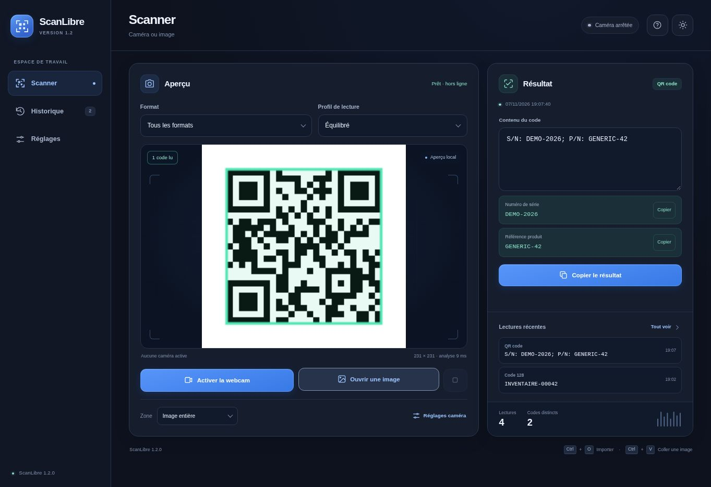

# ScanLibre

**Lecteur gratuit de Data Matrix, QR codes et codes-barres, toutes marques, avec webcam ou fichier image.**

ScanLibre 1.2.0 fonctionne dans un fichier HTML autonome. Le moteur de lecture est inclus : aucune installation, aucun abonnement, aucun compte et aucun serveur local ne sont nécessaires pour utiliser le fichier téléchargé. Le traitement des images reste sur l’appareil.

## Démarrer

### Version de test en ligne

[Ouvrir ScanLibre](https://scanlibre-test-m4d135.garden-lake-2660.chatgpt.site) dans un navigateur complet, puis autoriser la caméra ou ouvrir une image. Ce site de test est privé : utiliser le même compte ChatGPT que celui associé au projet si la page demande une connexion. Aucun téléchargement n’est nécessaire pour l’essayer.

La page hébergée nécessite une connexion pour être chargée ; son analyse des codes reste locale. Le fonctionnement hors ligne du fichier téléchargé ne constitue pas une garantie de mise en cache hors ligne du site.

### Fichier HTML autonome

1. Récupérer le **pack PROD** dans les [Releases du projet](https://github.com/M4D135/ScanLibre/releases).
2. Extraire l’archive dans un dossier local.
3. Ouvrir **`ScanLibre.html` dans Microsoft Edge ou Google Chrome**. Si le double-clic utilise une autre application, choisir **Ouvrir avec**.
4. Attendre l’état **Prêt · hors ligne**.
5. Cliquer sur **Activer la webcam** ou **Ouvrir une image**.

Le fichier doit être téléchargé et ouvert dans le navigateur. Un aperçu de fichier dans GitHub, une messagerie ou une autre application peut empêcher l’accès à la caméra.

La distribution PROD contient la version prête à utiliser, sous forme de fichier HTML à ouvrir dans le navigateur. Le pack DEV contient les sources et les fichiers nécessaires à la reconstruction. Après une compilation depuis les sources, le résultat se trouve dans `dist/ScanLibre.html`. Les fichiers générés sont distribués dans les Releases et ne sont pas suivis dans Git.

Deux images de démonstration entièrement fictives sont fournies dans `examples/` : un Data Matrix avec une paire d’identifiants fictifs et un QR contenant du texte.

## Navigation sur PC et mobile

Sur PC, le lecteur réunit l’aperçu et le résultat dans des panneaux alignés. Les trois dernières lectures et les compteurs de lectures/codes distincts restent accessibles à côté du résultat. **Historique** regroupe recherche, consultation, copie et export ; **Réglages** regroupe caméra, son, copie automatique et préférences d’affichage.

Sur mobile, la barre du bas donne accès à quatre écrans : **Scanner**, **Résultat**, **Historique** et **Réglages**. Une lecture caméra affiche une notification ouvrant le résultat, sans quitter le scanner automatiquement. Après un import d’images réussi, le résultat s’ouvre à la fin du lot uniquement si l’écran Scanner est toujours actif ; un autre écran consulté pendant l’import reste affiché.

Le bouton **Afficher** d’une entrée de l’historique et les lectures récentes ouvrent le résultat correspondant. Le retour à l’historique conserve la recherche et la position dans la liste.



[Capture du contrôle mobile à 390 × 844 px](docs/screenshots/mobile-qa-1.2.0.png) — aperçu du même fichier HTML dans un cadre responsive de Chrome, avec des données fictives.

## Lire une étiquette

### Avec la webcam

Cliquer sur **Activer la webcam** et accepter la demande d’accès du navigateur. Le choix de la caméra se trouve dans **Réglages**. Montrer le code entier avec une petite marge autour ; attendre une image nette avant de le rapprocher davantage. Sur une coque métallique, modifier légèrement l’angle pour éviter les reflets.

| Mode | Utilisation |
| --- | --- |
| **Tous les formats** | Détection automatique des formats pris en charge par le moteur. |
| **Data Matrix** | Étiquettes de matériel et autres codes de cette famille. |
| **QR code** | Codes de la famille QR. |
| **Codes-barres 1D** | Codes linéaires, par exemple Code 128, EAN ou UPC. |

Un Data Matrix utilise un format différent d’un QR code. Pour une étiquette de matériel non reconnue en mode QR, choisir **Data Matrix** ou **Tous les formats**.

La lecture est automatique. Un contour signale les codes reconnus ; le texte apparaît dans le panneau ou l’écran **Résultat**. Le format, le profil de lecture et la zone analysée sont accessibles directement dans le lecteur. Un code qui reste devant la webcam ne produit pas une nouvelle lecture à chaque image. Pour lire de nouveau ce même code, le retirer quelques secondes puis le représenter.

**Arrêter** ou **Échap** libère la webcam. Elle s’arrête également en ouvrant **Historique**, en ouvrant **Résultat** sur mobile ou lorsque l’onglet passe en arrière-plan ; au retour, cliquer de nouveau sur **Activer la webcam**. Elle reste active dans **Réglages**, avec le même aperçu vidéo pour observer les ajustements. L’application ne demande pas d’accès au microphone.

### Régler la caméra et améliorer la lecture

Dans **Réglages**, la définition préférée est **Full HD**. Le menu propose aussi une sélection automatique, **HD** et **Ultra HD**, ainsi que 15 ou 30 images/s. Ce sont des préférences : la définition et la cadence réellement obtenues sont affichées près de l’aperçu. Changer ces menus pendant la lecture relance proprement la caméra.

Les commandes matérielles apparaissent après activation de la caméra : mise au point automatique ou manuelle, distance de mise au point, zoom, exposition, luminosité, contraste, netteté, balance des blancs et éclairage intégré selon le modèle. Seules les fonctions exposées au navigateur sont proposées. Une commande manuelle dépendant d’un mode automatique reste désactivée tant que ce mode n’est pas passé en manuel. Un réglage refusé ou ignoré est signalé ; l’affichage reprend la valeur mesurée. **Réinitialiser** restaure les valeurs de départ de cette session caméra.

| Profil | Comportement |
| --- | --- |
| **Rapide** | Une seule passe et un aperçu analysé jusqu’à 1 280 pixels sur le plus grand côté. |
| **Équilibré** | Jusqu’à 1 920 pixels et une correction de contraste supplémentaire après un échec. |
| **Précision** | Jusqu’à 2 560 pixels ; davantage de tentatives pour les petits codes ou codes inclinés, au prix d’une analyse plus lente. |

**Lecture renforcée** autorise les tentatives supplémentaires. La **zone centrale** concentre la recherche dans le cadre indiqué, sans agrandir artificiellement l’aperçu ; le code doit y tenir en entier avec ses marges. Les fichiers importés sont toujours analysés sur l’image entière. Le profil Précision ne peut pas recréer des détails absents d’une image floue ou surexposée.

La métrique près de l’aperçu indique la définition analysée et la durée de la dernière analyse. La cadence de capture caméra et la cadence de décodage sont distinctes : ScanLibre attend la fin d’une analyse avant de commencer la suivante.

### Volume du bip et affichage

Dans **Réglages**, le **Volume du bip** varie de 0 à 100 %, avec un bouton **Tester le son**. Le niveau réellement audible dépend aussi du volume du navigateur, du système et des haut-parleurs. À 0 %, aucun bip n’est joué. Le bouton de test fonctionne même si les bips automatiques sont désactivés, afin de préparer le niveau avant de les activer.

Le thème sombre/clair, la taille d’interface (100 à 200 %), la densité **Confortable/Compacte** et les animations se règlent dans l’interface. Les animations proposent **Suivre l’appareil** (préférence système), **Expressives** et **Réduites**. Ces choix, le volume et les préférences de lecture sont mémorisés dans ce navigateur. La densité compacte resserre la présentation sur PC ; la navigation mobile conserve des commandes adaptées au toucher.

### Avec une image

Utiliser **Ouvrir une image**, déposer les fichiers dans la fenêtre ou coller une capture avec **Ctrl+V**. Les formats conseillés sont PNG, JPEG, WebP et BMP, selon les capacités du navigateur.

| Limite | Valeur |
| --- | --- |
| Fichiers sélectionnés en une fois | 50 images |
| Taille d’un fichier | 30 Mo maximum |
| Définition d’une image | 60 mégapixels maximum |
| Dimension utilisée pour le décodage | Réduction proportionnelle à 4 096 pixels sur le plus grand côté si nécessaire |

Les images sont lues l’une après l’autre. Le lecteur affiche les erreurs éventuelles et conserve les résultats des autres images du lot. Un import lancé depuis un autre écran ouvre Scanner ; sur mobile, le résultat s’ouvre après la fin d’un lot réussi si Scanner est toujours affiché.

## Copier les informations

Le menu **Contenu à copier**, dans **Réglages**, s’applique au bouton principal, aux boutons de l’historique et à la copie automatique :

- **Contenu complet** : texte exact renvoyé par le code.
- **Numéro de série (si identifié)** : champ explicitement nommé ou extrait d’une structure reconnue.
- **Référence produit (si identifiée)** : champ explicitement nommé ou extrait d’une structure reconnue.

Si le champ demandé n’est pas identifié, la copie reprend le contenu complet. Les boutons **Copier** des cartes permettent aussi de copier directement chaque champ. Une simple suite de chiffres n’est pas automatiquement interprétée comme un numéro de série.

Les champs nommés sont reconnus dans les étiquettes texte (`S/N: ABC-123; P/N: PART-42`, `serial_number=ABC-123`, `Numéro de série: ABC-123`) et dans un objet JSON contenant des chaînes `serial`/`product`, entre autres alias. Des champs contradictoires ne sont pas extraits. Le contenu brut est toujours conservé.

Exemple entièrement fictif d’une autre structure reconnue :

```text
AB01234567,ZZ123AA#ABF
```

Le lecteur reconnaît ici un numéro de série de 10 caractères alphanumériques majuscules et une référence de 7 caractères suivie de `#` et de 3 caractères. Cette extraction vérifie la structure du texte ; elle n’interroge pas le fabricant et ne valide pas une garantie. Un code comportant d’autres données reste disponible dans son intégralité.

Activer **Copie automatique** pour mettre les nouveaux résultats dans le presse-papiers, puis utiliser **Ctrl+V** dans Excel, GLPI ou un autre logiciel. Cette version ne comporte pas d’injection clavier globale dans une autre fenêtre. Les autorisations du navigateur peuvent limiter la copie automatique ; la copie manuelle reste proposée en cas de refus.

Un lien HTTP ou HTTPS peut être ouvert avec **Ouvrir le lien**. La lecture seule n’ouvre aucune page automatiquement.

## Historique et export CSV

L’historique contient au maximum **500 codes distincts**, identifiés par leur format et leur contenu. Une nouvelle lecture d’un code déjà connu actualise sa date, son compteur et sa position dans la liste. Lorsque la limite est atteinte, les entrées les plus anciennes sortent du journal. Les compteurs affichés portent sur les entrées conservées.

Par défaut, les résultats restent en mémoire pendant la session. Activer **Conserver l’historique** dans **Réglages** pour les enregistrer dans le stockage local du navigateur. Désactiver cette option supprime la copie enregistrée, tout en gardant la liste de la session ouverte. Cette mémorisation dépend des autorisations de stockage du navigateur. Les préférences d’affichage et de lecture sont enregistrées séparément ; les images ne sont pas conservées.

**Vider** demande une confirmation intégrée à l’écran Historique. **Annuler** conserve les données ; confirmer efface l’historique, le résultat courant et les compteurs. Aucun dialogue séparé du navigateur n’est nécessaire.

**Exporter CSV** exporte tout l’historique, y compris les lignes masquées par une recherche. Le fichier utilise UTF-8 avec BOM, le séparateur `;` et les colonnes suivantes :

| Colonne | Contenu |
| --- | --- |
| Date | Date de la dernière lecture au format ISO, en UTC. |
| Format | Famille de code reconnue. |
| Contenu | Texte décodé. |
| Numéro de série | Champ lorsqu’il est identifié. |
| Référence produit | Champ lorsqu’il est identifié. |

Les guillemets, accents et sauts de ligne sont conservés. Les valeurs susceptibles d’être interprétées comme des formules de tableur sont précédées d’une apostrophe dans le CSV. Le texte affiché et copié dans l’application reste inchangé.

## Fonctionnement local

Le fichier embarque son JavaScript, ses styles et le moteur WebAssembly. Il n’utilise ni CDN ni API distante pour lire les codes. Une politique de contenu interdit les connexions réseau de l’application avec `connect-src 'none'`. L’ouverture volontaire d’un lien reconnu lance séparément la navigation demandée.

Le fichier téléchargé ne démarre aucun serveur et n’ouvre aucun port local. Une connexion est nécessaire pour télécharger le pack ou installer les dépendances de développement, puis la lecture fonctionne localement. La version hébergée utilise le même lecteur embarqué après le chargement de sa page privée.

## Résoudre un problème

| Symptôme | Vérification utile |
| --- | --- |
| Aucun code reconnu | Choisir **Tous les formats** ou **Data Matrix**, montrer tout le code, vérifier la netteté et les reflets. Essayer aussi une photo nette pour distinguer un problème d’image d’un problème de caméra. |
| Demande caméra refusée | Vérifier l’autorisation caméra du site ou du fichier dans le navigateur et les autorisations du navigateur dans les réglages de l’appareil. Une règle d’entreprise peut empêcher cet accès. |
| Webcam occupée | Fermer Caméra Windows, Teams ou l’application qui utilise déjà la webcam, puis réessayer. |
| Caméra arrêtée après une navigation | Revenir dans Scanner et cliquer sur **Activer la webcam**. L’arrêt est prévu en arrière-plan, dans Historique et dans Résultat sur mobile. |
| Copie refusée | Utiliser la copie manuelle proposée et **Ctrl+C**, puis **Ctrl+V** dans le logiciel de destination. |
| Historique non conservé | Vérifier l’option **Conserver l’historique**. Si le stockage du navigateur n’est pas disponible, exporter le CSV avant de fermer la fenêtre. |
| Moteur indisponible ou aperçu intégré | Ouvrir le lien hébergé directement dans le navigateur ou le fichier HTML complet téléchargé, puis recharger. |
| Le site de test demande une connexion | Utiliser le compte ChatGPT associé au projet ; le site est privé. Le fichier HTML téléchargé fonctionne sans compte. |

**Qualification :** les vérifications réalisées et leurs limites sont décrites dans [`docs/VALIDATION.md`](docs/VALIDATION.md). Une interface adaptée au mobile ne remplace pas un essai de la caméra et du son sur l’appareil cible.

## Développer et reconstruire

Prérequis : **Node.js 20 ou supérieur** et npm.

```sh
npm ci
npm test
npm run build
```

Pour régénérer les exemples et produire les archives PROD/DEV (Python 3 est nécessaire uniquement pour l’empaquetage) :

```sh
node scripts/generate-examples.mjs
python scripts/package.py
```

Les archives et leurs sommes SHA-256 se trouvent dans `artifacts/`.

Le build produit `dist/ScanLibre.html` et incorpore le moteur ainsi que les notices de licence. Modifier les fichiers de `src/`, puis reconstruire ; le fichier généré n’est pas la source à éditer.

| Élément | Rôle |
| --- | --- |
| `src/index.html`, `src/styles.css` | Interface française, thèmes sombre et clair. |
| `src/app.js` | Webcam, images, résultats, presse-papiers et historique. |
| `src/ui.js` | Navigation responsive, écrans mobile, notifications et préférences d’animation/densité. |
| `src/decoder.js`, `src/detection.js` | Moteur local, profils de lecture, contraste et zone centrale. |
| `src/camera.js` | Capacités caméra, application et vérification des réglages. |
| `src/sound.js` | Volume et génération du bip de confirmation. |
| `src/core.js` | Extraction de champs nommés, validation des liens et export CSV. |
| `scripts/build.mjs` | Construction du fichier HTML autonome. |
| `tests/` | Tests du moteur et des traitements des données. |

Versions verrouillées dans `package-lock.json` : **zxing-wasm 3.1.6** et **esbuild 0.28.2**. Le moteur de lecture repose sur ZXing-C++.

## Licence et références

Le code de ScanLibre est distribué sous [licence MIT](LICENSE). Les bibliothèques embarquées conservent leurs licences respectives, notamment MIT et Apache-2.0. Voir [`THIRD_PARTY_NOTICES.txt`](THIRD_PARTY_NOTICES.txt).

- [ZXing WebAssembly : documentation du projet](https://github.com/Sec-ant/zxing-wasm)
- [MDN : accès à la caméra avec `getUserMedia`](https://developer.mozilla.org/en-US/docs/Web/API/MediaDevices/getUserMedia)
- [MDN : capacités réellement proposées par la caméra](https://developer.mozilla.org/en-US/docs/Web/API/MediaStreamTrack/getCapabilities)
- [MDN : application des contraintes caméra](https://developer.mozilla.org/en-US/docs/Web/API/MediaStreamTrack/applyConstraints)

MDN décrit les fichiers `file:///` parmi les contextes pouvant accéder à `getUserMedia`. La permission du navigateur et les politiques du poste continuent de s’appliquer.
