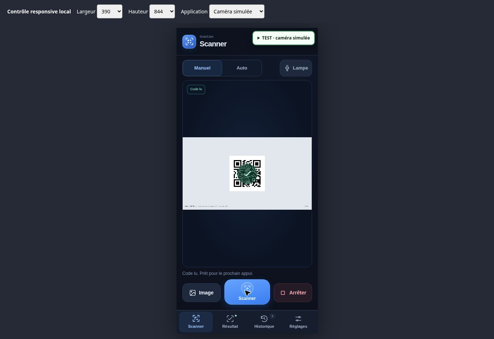
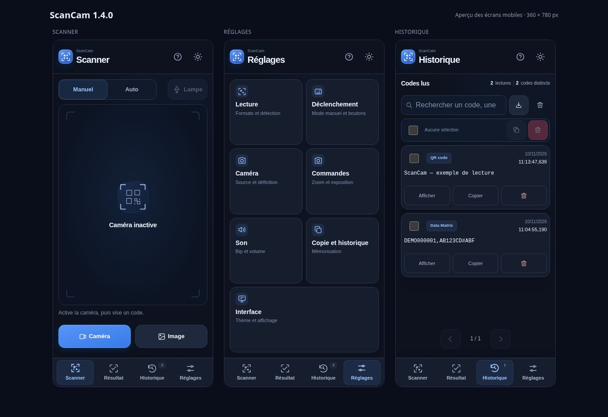

# ScanCam

**Lecteur gratuit de Data Matrix, QR codes et codes-barres, toutes marques, avec webcam ou fichier image.**

ScanCam 1.4.1 fonctionne dans un fichier HTML autonome. Le moteur de lecture est inclus : aucune installation, aucun abonnement, aucun compte et aucun serveur local ne sont nécessaires pour utiliser le fichier téléchargé. Le traitement des images reste sur l’appareil.

La version **1.4.1** dégage l’aperçu dès qu’un code est validé : le cadre de visée disparaît, une petite coche verte confirme la lecture pendant **650 ms**, puis s’efface. En manuel, le cadre revient au prochain appui sur **Scanner**. Le grand bandeau mobile « Code lu » est supprimé ; le résultat reste accessible par son onglet et son indicateur. Le retour visuel reste bref et statique lorsque les animations sont réduites.

La version **1.4.0** démarre la caméra en **visée manuelle** : viser, puis appuyer sur **Scanner** pour lire un seul code dans le cadre central. Elle ajoute la lampe à portée de main, un déclencheur clavier configurable avec association et test, et une interface fixe sur PC comme sur mobile. Réglages se parcourt par catégories ; l’historique utilise des pages adaptées à la place disponible. Le mode **Auto** reste accessible et son choix est mémorisé.

La version **1.3.0** ajoute la suppression individuelle et la sélection de plusieurs scans pour les copier, les exporter ou les supprimer ensemble. Les suppressions demandent confirmation. La date de dernière lecture affiche désormais l’heure locale jusqu’aux millisecondes, avec le fuseau indiqué dans l’en-tête du tableau.

La version **1.2.5** retire les mentions répétées du nom et du numéro de version : ils figurent une seule fois, en haut de la colonne latérale sur PC. Les pieds de page sont supprimés. Les panneaux de Réglages s’alignent en hauteur, avec un aperçu caméra adaptable, et les titres suivent les mêmes marges que les panneaux sur grand écran.

La version **1.2.4** renomme ScanLibre en **ScanCam**, dans l’application, le fichier HTML et les packs. Les clés de stockage existantes sont conservées : les réglages et l’historique enregistré restent accessibles sur la même adresse, dans le même profil de navigateur.

La version 1.2.3 simplifie Scanner autour de l’aperçu et des actions **Caméra / Image**. **Format**, **Profil de lecture**, **Zone de recherche** et **Lecture renforcée** sont réunis dans **Réglages → Lecture**. Le bouton caméra laisse place à **Arrêter** pendant la capture ou à **Annuler** pendant le démarrage et l’import. Les informations de la caméra et de la dernière analyse se trouvent dans **Réglages → Caméra**.

La version 1.2.2 fixe la navigation mobile au bord inférieur, sur toute la largeur, et retire le raccourci Réglages caméra redondant à côté du choix de zone. Le contenu défile au-dessus de la barre ; les quatre écrans restent accessibles en permanence.

Le moteur conserve les améliorations de la version 1.2.1 : récupération des Data Matrix pâles sur un fond irrégulier et compatibilité ciblée pour un terminateur redondant rencontré sur certaines étiquettes, avec vérification indépendante de la correction d’erreurs et concordance exacte du contenu décodé.

## Démarrer

### Version en ligne

[Ouvrir ScanCam sur scan.estrasse.fr](https://scan.estrasse.fr) dans un navigateur complet, puis autoriser la caméra ou ouvrir une image. C’est l’adresse principale du lecteur en ligne ; aucun téléchargement n’est nécessaire pour l’essayer.

Le [site de test privé](https://scanlibre-test-m4d135.garden-lake-2660.chatgpt.site) reste disponible en alternative. Il demande le compte ChatGPT associé au projet si la session n’est pas déjà ouverte.

La page hébergée nécessite une connexion Internet pour être chargée ; son analyse des codes reste locale. Le fonctionnement hors ligne du fichier téléchargé ne constitue pas une garantie de mise en cache hors ligne du site.

### Fichier HTML autonome

1. Récupérer le **pack PROD** dans les [Releases du projet](https://github.com/M4D135/ScanCam/releases).
2. Extraire l’archive dans un dossier local.
3. Ouvrir **`ScanCam.html` dans Microsoft Edge ou Google Chrome**. Si le double-clic utilise une autre application, choisir **Ouvrir avec**.
4. Cliquer sur **Activer la webcam** (**Caméra** sur mobile) et autoriser la caméra.
5. En mode **Manuel**, placer le code entier dans le cadre central, attendre une image nette, puis appuyer sur **Scanner**. Un nouvel appui lance la lecture suivante.
6. Pour lire en continu, choisir explicitement **Auto**. Pour un fichier, utiliser **Ouvrir une image** (**Image** sur mobile) : l’image entière est analysée.
7. Les paramètres de détection se trouvent dans **Réglages → Lecture** ; la durée de recherche et les raccourcis sont dans **Déclenchement**.

Le fichier doit être téléchargé et ouvert dans le navigateur. Un aperçu de fichier dans GitHub, une messagerie ou une autre application peut empêcher l’accès à la caméra.

La distribution `ScanCam-1.4.1-PROD.zip` contient la version prête à utiliser, sous forme de fichier HTML à ouvrir dans le navigateur. Le pack `ScanCam-1.4.1-DEV.zip` contient les sources et les fichiers nécessaires à la reconstruction. Après une compilation depuis les sources, le résultat se trouve dans `dist/ScanCam.html`. Les fichiers générés sont distribués dans les Releases et ne sont pas suivis dans Git.

Trois images de démonstration entièrement fictives sont fournies dans `examples/` : un Data Matrix avec une paire d’identifiants fictifs, un QR contenant du texte et `data-matrix-pale.png`, un petit Data Matrix peu contrasté sur fond texturé.

## Navigation sur PC et mobile

**Scanner** réunit l’aperçu, le choix **Manuel / Auto**, la lampe et les actions caméra/image. Lorsque la caméra est active en manuel, le bouton **Scanner** déclenche une lecture. Les paramètres de détection sont regroupés dans **Réglages → Lecture**.

L’application tient dans la fenêtre, **sans défilement global des pages**, sur PC comme sur mobile. Sur PC, l’aperçu et le résultat occupent des panneaux alignés. **Historique** regroupe recherche, pages, sélection, copie, export et suppression. **Réglages** propose les catégories **Lecture**, **Déclenchement**, **Caméra**, **Commandes**, **Son**, **Copie et historique** et **Interface**, ouvertes une à une. Les commandes matérielles de la caméra se parcourent également par pages si nécessaire.

Sur mobile, la barre fixée en bas donne accès à quatre écrans : **Scanner**, **Résultat**, **Historique** et **Réglages**. Son fond englobe la zone de sécurité indiquée par le navigateur pour la barre d’accueil de l’appareil. La visée reste fixe sous les gestes du doigt. Dans **Résultat**, les vues **Contenu / Champs** séparent le texte brut des informations reconnues. Un texte long peut défiler à l’intérieur de son champ sans déplacer la page ; le zoom du navigateur reste possible.

Une lecture caméra affiche brièvement une coche verte, sans quitter le scanner ni déplacer son contenu. Les contours de détection ne restent pas sur la vidéo. L’onglet **Résultat** permet de consulter le dernier code et un indicateur signale un nouveau résultat sur mobile. Après un import d’images réussi, le résultat s’ouvre à la fin du lot uniquement si l’écran Scanner est toujours actif ; un autre écran consulté pendant l’import reste affiché.

Le bouton **Afficher** d’une entrée de l’historique et les lectures récentes ouvrent le résultat correspondant. Le retour à l’historique conserve la recherche et la page consultée, dans les limites du nombre d’entrées encore présentes.



Aperçu du retour visuel dans un cadre de 390 × 844 px, avec une caméra simulée et un QR fictif.



Aperçu du HTML de production dans trois cadres de 360 × 780 px ; les codes affichés sont fictifs.

[Historique avec sélection multiple en 1.3.0](docs/screenshots/scancam-1.3.0.png)

[Panneaux de Réglages alignés dans ScanCam 1.2.5](docs/screenshots/scancam-1.2.5.png)

[Interface avant simplification 1.2.4](docs/screenshots/scancam-1.2.4.png)

[Ancienne interface PC de ScanLibre 1.2.0](docs/screenshots/desktop-1.2.0.png)

[Capture du Scanner épuré 1.2.3](docs/screenshots/scanner-1.2.3.png) — aperçu mobile sous le nom ScanLibre, avant le renommage 1.2.4.

[Capture de la navigation mobile 1.2.2](docs/screenshots/mobile-nav-1.2.2.png) — aperçu dans un cadre responsive de Chrome. L’ancienne capture PC 1.2.0 et [l’ancienne capture mobile](docs/screenshots/mobile-qa-1.2.0.png) datent de la qualification de l’interface 1.2.0 du 7 novembre 2026. Les contrôles responsive ne remplacent pas une qualification sur Safari et sur un téléphone physique.

## Lire une étiquette

### Avec la webcam

Cliquer sur **Activer la webcam** (**Caméra** sur mobile) et accepter la demande d’accès du navigateur. Le choix de la caméra se trouve dans **Réglages → Caméra** ; le menu **Format** est dans **Réglages → Lecture**. Montrer le code entier avec une petite marge autour ; attendre une image nette avant de le rapprocher davantage. Sur une coque métallique, modifier légèrement l’angle pour éviter les reflets.

| Mode | Utilisation |
| --- | --- |
| **Tous les formats** | Détection automatique des formats pris en charge par le moteur. |
| **Data Matrix** | Étiquettes de matériel et autres codes de cette famille. |
| **QR code** | Codes de la famille QR. |
| **Codes-barres 1D** | Codes linéaires, par exemple Code 128, EAN ou UPC. |

Un Data Matrix utilise un format différent d’un QR code. Pour une étiquette de matériel non reconnue en mode QR, choisir **Data Matrix** ou **Tous les formats**.

**Manuel est le mode initial.** L’aperçu sert à viser ; aucun décodage ne tourne tant que **Scanner** n’a pas été déclenché. À chaque appui, le lecteur recherche dans le cadre central et enregistre **un seul code**, le plus proche du centre parmi les codes reconnus. La recherche s’arrête dès cette lecture ou à la fin du délai choisi dans **Réglages → Déclenchement** : **1,5 seconde**, **3 secondes** par défaut, ou **5 secondes**. Si aucun code n’est lu, ajuster la visée puis réessayer. Les appuis reçus pendant une recherche ne s’empilent pas.

Un nouvel appui peut relire le même article sans le sortir du cadre : son compteur augmente d’une lecture. Une petite coche confirme le code retenu, puis l’aperçu reste dégagé jusqu’au prochain appui, qui réaffiche le cadre. Son contenu apparaît dans **Résultat**. Le passage en **Auto** lance explicitement la lecture continue et mémorise ce choix. Dans ce mode, la zone choisie dans **Réglages → Lecture** s’applique ; un code restant devant la caméra ne compte pas à chaque image et ne répète pas la confirmation visuelle. Pour le relire automatiquement, le retirer quelques secondes puis le représenter. Le cadre du mode Auto revient lorsque la vue ne contient plus de code détecté. Le mode manuel utilise toujours son cadre central, quel que soit le réglage de zone du mode Auto.

Dans Scanner, **Annuler** remplace le bouton caméra pendant son ouverture ; **Arrêter** le remplace une fois la capture active. Pendant une recherche manuelle, **Échap** annule cette tentative et laisse l’aperçu actif ; hors recherche, il arrête la caméra. **Arrêter** libère toujours la webcam. Elle s’arrête également en ouvrant **Historique**, en ouvrant **Résultat** sur mobile ou lorsque l’onglet passe en arrière-plan ; au retour, cliquer de nouveau sur **Activer la webcam** (**Caméra** sur mobile). Elle reste active dans **Réglages** pour observer les ajustements, mais une tentative manuelle en cours est annulée en quittant Scanner. L’application ne demande pas d’accès au microphone.

### Déclencher avec un bouton ou une touche

Dans **Réglages → Déclenchement**, choisir **Bouton à l’écran uniquement**, **Barre d’espace**, **Entrée** ou **Touche associée**. **Associer un bouton** attend une touche réellement reçue du clavier ou d’une télécommande ; **Tester le bouton** vérifie sa réception sans enregistrer de scan. Ces raccourcis fonctionnent dans Scanner, caméra active, en mode manuel, en dehors des champs de saisie et des autres commandes. Les combinaisons Ctrl/Alt/Commande/Maj, les touches de navigation réservées et les répétitions d’un appui maintenu ne déclenchent pas de lectures supplémentaires.

**Les boutons Volume du téléphone ne sont pas garantis dans une page HTML.** Le [code Chromium Android consulté](https://chromium.googlesource.com/chromium/src/+/27c7fe6e7a57093e09bcdb675cc6cfedac716110/content/public/android/java/src/org/chromium/content/browser/ContentUiEventHandler.java) écarte Volume et Camera avant leur transmission au contenu web. Apple propose la capture par boutons physiques avec son [API native `AVCaptureEventInteraction`](https://developer.apple.com/documentation/avkit/avcaptureeventinteraction), qui n’est pas une API JavaScript du lecteur. La [norme des touches clavier](https://www.w3.org/TR/uievents-key/) ne garantit pas leur disponibilité sur chaque appareil. ScanCam associe seulement les événements qu’il reçoit ; aucune simulation de volume ou interception du système n’est utilisée. Une télécommande envoyant Espace ou Entrée peut servir de déclencheur si le navigateur la reconnaît : effectuer le test d’association sur le téléphone concerné.

### Allumer la lampe

Le bouton **Lampe** dans Scanner agit sur l’éclairage de la caméra active. Il est disponible uniquement lorsque le navigateur expose une commande utilisable, et son état reflète les valeurs confirmées par le matériel. Un refus ou une commande ignorée est signalé. Le bouton est désactivé pendant une lecture manuelle ou l’application d’un réglage ; attendre la fin de cette opération pour le basculer. Arrêter ou remplacer la caméra libère sa piste vidéo et son éclairage. La présence d’un flash sur le téléphone ne suffit pas à garantir que le navigateur permette de le piloter.

### Régler la caméra et améliorer la lecture

Dans **Réglages → Caméra**, la définition préférée est **Full HD**. Le menu propose aussi une sélection automatique, **HD** et **Ultra HD**, ainsi que 15 ou 30 images/s. Ce sont des préférences : la définition et la cadence réellement obtenues sont affichées sous l’aperçu de cette section. Changer ces menus pendant la lecture relance proprement la caméra.

Dans **Réglages → Commandes**, les commandes matérielles apparaissent après activation de la caméra : mise au point automatique ou manuelle, distance de mise au point, zoom, exposition, luminosité, contraste, netteté, balance des blancs et éclairage intégré selon le modèle. Seules les fonctions exposées au navigateur sont proposées. Les pages permettent de les consulter sans faire défiler l’application. Une commande manuelle dépendant d’un mode automatique reste désactivée tant que ce mode n’est pas passé en manuel. Un réglage refusé ou ignoré est signalé ; l’affichage reprend la valeur mesurée. **Réinitialiser** restaure les valeurs de départ de cette session caméra.

Les paramètres de détection se trouvent dans **Réglages → Lecture**. Le menu **Profil de lecture** propose :

| Profil | Comportement |
| --- | --- |
| **Rapide** | Une seule passe et un aperçu analysé jusqu’à 1 280 pixels sur le plus grand côté. |
| **Équilibré** | Jusqu’à 1 920 pixels ; récupération du contraste local des codes 2D pâles, en clair comme en sombre, puis correction globale selon le besoin et le budget de recherche. |
| **Précision** | Jusqu’à 2 560 pixels ; davantage de tentatives pour les petits codes ou codes inclinés, au prix d’une analyse plus lente. |

**Lecture renforcée** autorise les tentatives supplémentaires. La **zone centrale**, systématique en manuel et sélectionnable en Auto, concentre la recherche dans le cadre indiqué, sans agrandir artificiellement l’aperçu ; le code doit y tenir en entier avec ses marges. Les fichiers importés sont toujours analysés sur l’image entière, et tous les résultats reconnus sont conservés. Le profil Précision ne peut pas recréer des détails absents d’une image floue ou surexposée.

Après une lecture simple infructueuse, la récupération locale compare le code à son voisinage pour limiter l’influence d’une grande zone sombre ou d’un reflet ailleurs dans l’image. Elle fonctionne dans **Équilibré** et **Précision** lorsque la lecture renforcée est active. Le traitement conserve les pixels d’origine et limite ses images de travail à 4 mégapixels ; les contours reconnus sont replacés dans l’aperçu original.

La compatibilité Data Matrix ne concerne qu’un terminateur ASCII redondant juste avant le remplissage final. Elle exige une nouvelle extraction des modules, une validation Reed–Solomon indépendante, des octets de remplissage conformes et un texte exactement identique aux octets décodés. Les autres erreurs de format et les codes dont la correction d’erreurs échoue restent refusés.

Dans **Réglages → Caméra**, **Dernière analyse** indique la définition analysée et la durée de la dernière analyse, y compris après un import d’image. La cadence de capture caméra et la cadence de décodage sont distinctes : ScanCam attend la fin d’une analyse avant de commencer la suivante.

### Volume du bip et affichage

Dans **Réglages → Son**, le **Volume du bip** varie de 0 à 100 %, avec un bouton **Tester le son**. Le niveau réellement audible dépend aussi du volume du navigateur, du système et des haut-parleurs. À 0 %, aucun bip n’est joué. Le bouton de test fonctionne même si les bips automatiques sont désactivés, afin de préparer le niveau avant de les activer.

Le thème sombre/clair se change avec le bouton de thème. La taille d’interface (100 à 200 %), la densité **Confortable/Compacte** et les animations se règlent dans **Réglages → Interface**. Les animations proposent **Suivre l’appareil** (préférence système), **Expressives** et **Réduites**. Ces choix, le volume et les préférences de lecture sont mémorisés dans ce navigateur. La densité compacte resserre la présentation sur PC ; la navigation mobile conserve des commandes adaptées au toucher.

### Avec une image

Utiliser **Ouvrir une image** (**Image** sur mobile), déposer les fichiers dans la fenêtre ou coller une capture avec **Ctrl+V**. Les formats conseillés sont PNG, JPEG, WebP et BMP, selon les capacités du navigateur. L’import analyse toujours l’image entière et conserve tous les codes reconnus, indépendamment du mode Manuel ou Auto de la caméra.

| Limite | Valeur |
| --- | --- |
| Fichiers sélectionnés en une fois | 50 images |
| Taille d’un fichier | 30 Mo maximum |
| Définition d’une image | 60 mégapixels maximum |
| Dimension utilisée pour le décodage | Réduction proportionnelle à 4 096 pixels sur le plus grand côté si nécessaire |

Les images sont lues l’une après l’autre. Pendant l’import, **Annuler** remplace le bouton caméra dans Scanner et permet d’interrompre le traitement. Le lecteur affiche les erreurs éventuelles et conserve les résultats des images déjà lues. Un import lancé depuis un autre écran ouvre Scanner ; sur mobile, le résultat s’ouvre après la fin d’un lot réussi si Scanner est toujours affiché.

## Copier les informations

Le menu **Contenu à copier**, dans **Réglages → Copie et historique**, s’applique au bouton principal, aux copies individuelles ou groupées de l’historique et à la copie automatique :

- **Contenu complet** : texte exact renvoyé par le code.
- **Numéro de série (si identifié)** : champ explicitement nommé ou extrait d’une structure reconnue.
- **Référence produit (si identifiée)** : champ explicitement nommé ou extrait d’une structure reconnue.

Si le champ demandé n’est pas identifié, la copie reprend le contenu complet. Les boutons **Copier** des cartes permettent aussi de copier directement chaque champ. Une simple suite de chiffres n’est pas automatiquement interprétée comme un numéro de série.

Les champs nommés sont reconnus dans les étiquettes texte (`S/N: ABC-123; P/N: PART-42`, `serial_number=ABC-123`, `Numéro de série: ABC-123`) et dans un objet JSON contenant des chaînes `serial`/`product`, entre autres alias. Des champs contradictoires ne sont pas extraits. Le contenu brut est toujours conservé.

Exemple entièrement fictif d’une autre structure reconnue :

```text
AB01234567,ZZ123AA#ABF
```

Le lecteur reconnaît ici un numéro de série de 10 caractères alphanumériques majuscules et une référence de 7 caractères suivie de `#` et de 3 caractères. Cette extraction vérifie la structure du texte ; elle n’interroge pas le fabricant et ne valide pas une garantie. Un code comportant d’autres données reste disponible dans son intégralité.

Activer **Copie automatique** pour mettre les nouveaux résultats dans le presse-papiers, puis utiliser **Ctrl+V** dans Excel, GLPI ou un autre logiciel. Cette version ne comporte pas d’injection clavier globale dans une autre fenêtre. Les autorisations du navigateur peuvent limiter la copie automatique ; la copie manuelle reste proposée en cas de refus.

Un lien HTTP ou HTTPS peut être ouvert avec **Ouvrir le lien**. La lecture seule n’ouvre aucune page automatiquement.

## Historique et export CSV

L’historique contient au maximum **500 codes distincts**, identifiés par leur format et leur contenu. Une nouvelle lecture d’un code déjà connu actualise sa date, son compteur et sa position dans la liste. Lorsque la limite est atteinte, les entrées les plus anciennes sortent du journal. Les compteurs affichés portent sur les entrées conservées.

**Date et heure** désigne la **dernière lecture** de la ligne, et non sa première apparition. La date et l’heure locale sont affichées séparément, avec secondes et millisecondes. Le fuseau du navigateur figure dans l’en-tête du tableau ; l’horodatage ISO est également disponible dans l’infobulle.

Par défaut, les résultats restent en mémoire pendant la session. Activer **Conserver l’historique** dans **Réglages → Copie et historique** pour les enregistrer dans le stockage local du navigateur. Désactiver cette option supprime la copie enregistrée, tout en gardant la liste de la session ouverte. Cette mémorisation dépend des autorisations de stockage du navigateur. Les préférences d’affichage et de lecture sont enregistrées séparément ; les images ne sont pas conservées.

L’historique utilise des pages dont le nombre de lignes s’adapte à la hauteur disponible. Les flèches changent de page sans faire défiler l’application ; une suppression ou une recherche ramène au besoin sur une page existante.

Cocher les lignes à traiter. **Tout sélectionner** sélectionne l’ensemble de l’historique. Lorsqu’une recherche est active, **Sélectionner les résultats** sélectionne **toutes les lignes correspondant au filtre, sur toutes les pages**. La sélection reste active en changeant de page ou de recherche. Le nombre de scans cochés sur d’autres pages ou masqués par le filtre est indiqué par **non affichés**. La croix **Tout désélectionner** retire toute la sélection, y compris ces lignes.

Le bouton **Copier** de la barre de sélection réunit les scans cochés dans l’ordre de l’historique, séparés par un retour à la ligne. Le réglage **Contenu à copier** s’applique à chaque entrée. **Supprimer** dans cette barre demande confirmation du nombre de scans concernés, en précisant combien ne sont pas affichés sur la page courante. **Annuler** ou **Échap** conserve les données.

La **corbeille** d’une ligne permet aussi de supprimer un seul scan, avec confirmation **Annuler / Supprimer** dans cette ligne. Une suppression retire l’entrée entière et ses relectures regroupées. Les autres entrées et la recherche restent en place ; les compteurs, lectures récentes et données enregistrées sont actualisés. Si le résultat courant fait partie des entrées supprimées, son panneau revient à son état vide.

**Vider** demande une confirmation intégrée à l’écran Historique. **Annuler** conserve les données ; confirmer efface l’historique, le résultat courant et les compteurs. Aucun dialogue séparé du navigateur n’est nécessaire.

Lorsqu’au moins une ligne est cochée, le bouton devient **Exporter la sélection** et exporte seulement les scans cochés, y compris ceux sur d’autres pages ou masqués par le filtre. Sans sélection, **Exporter CSV** exporte tout l’historique, indépendamment de la page et du filtre affichés. Le fichier utilise UTF-8 avec BOM, le séparateur `;` et les colonnes suivantes :

| Colonne | Contenu |
| --- | --- |
| Date | Date et heure de la dernière lecture au format ISO, en UTC, avec millisecondes. |
| Format | Famille de code reconnue. |
| Contenu | Texte décodé. |
| Numéro de série | Champ lorsqu’il est identifié. |
| Référence produit | Champ lorsqu’il est identifié. |

Les guillemets, accents et sauts de ligne sont conservés. Les valeurs susceptibles d’être interprétées comme des formules de tableur sont précédées d’une apostrophe dans le CSV. Le texte affiché et copié dans l’application reste inchangé.

## Fonctionnement local

Le fichier embarque son JavaScript, ses styles et le moteur WebAssembly. Il n’utilise ni CDN ni API distante pour lire les codes. Une politique de contenu interdit les connexions réseau de l’application avec `connect-src 'none'`. L’ouverture volontaire d’un lien reconnu lance séparément la navigation demandée.

Le fichier téléchargé ne démarre aucun serveur et n’ouvre aucun port local. Une connexion est nécessaire pour télécharger le pack ou installer les dépendances de développement, puis la lecture fonctionne localement. Les versions hébergées utilisent le même lecteur embarqué après le chargement de leur page.

## Résoudre un problème

| Symptôme | Vérification utile |
| --- | --- |
| L’image caméra s’affiche mais rien n’est lu | **Manuel** est le mode initial : viser le code entier dans le cadre puis appuyer sur **Scanner**. Choisir **Auto** pour déclencher la lecture continue. |
| Aucun code reconnu | Dans **Réglages → Lecture**, choisir **Tous les formats** ou **Data Matrix**, montrer tout le code, vérifier la netteté et les reflets. Essayer aussi une photo nette pour distinguer un problème d’image d’un problème de caméra. |
| Data Matrix très pâle | Dans **Réglages → Lecture**, utiliser **Équilibré** ou **Précision** avec **Lecture renforcée** activée. La correction locale est automatique ; conserver le code entier et ses marges, puis ajuster l’angle si un reflet masque des modules. |
| Demande caméra refusée | Vérifier l’autorisation caméra du site ou du fichier dans le navigateur et les autorisations du navigateur dans les réglages de l’appareil. Une règle d’entreprise peut empêcher cet accès. |
| Webcam occupée | Fermer Caméra Windows, Teams ou l’application qui utilise déjà la webcam, puis réessayer. |
| Caméra arrêtée après une navigation | Revenir dans Scanner et cliquer sur **Activer la webcam** (**Caméra** sur mobile). L’arrêt est prévu en arrière-plan, dans Historique et dans Résultat sur mobile. |
| Lampe indisponible ou sans effet | Vérifier la caméra sélectionnée. Le navigateur doit exposer et appliquer cette commande ; le bouton signale une commande absente, refusée ou ignorée. |
| Bouton du téléphone non reçu | Utiliser **Associer un bouton**, puis **Tester le bouton** dans **Réglages → Déclenchement**. Les boutons Volume restent souvent réservés au système ; utiliser le bouton **Scanner** ou une touche de clavier reconnue. |
| Copie refusée | Utiliser la copie manuelle proposée et **Ctrl+C**, puis **Ctrl+V** dans le logiciel de destination. |
| Historique non conservé | Vérifier l’option **Conserver l’historique**. Si le stockage du navigateur n’est pas disponible, exporter le CSV avant de fermer la fenêtre. |
| Moteur indisponible ou aperçu intégré | Ouvrir le lien hébergé directement dans le navigateur ou le fichier HTML complet téléchargé, puis recharger. |
| Le site de test privé demande une connexion | Utiliser le compte ChatGPT associé au projet, ou ouvrir le site principal [scan.estrasse.fr](https://scan.estrasse.fr). Le fichier HTML téléchargé fonctionne sans compte. |

**Qualification :** les vérifications réalisées et leurs limites sont décrites dans [`docs/VALIDATION.md`](docs/VALIDATION.md). Une interface adaptée au mobile ne remplace pas un essai de la caméra et du son sur l’appareil cible.

## Développer et reconstruire

Prérequis : **Node.js 24 ou supérieur** et npm.

```sh
npm ci
npm test
npm run build
```

Pour régénérer les deux exemples de base et produire les archives PROD/DEV (Python 3 est nécessaire uniquement pour l’empaquetage) :

```sh
node scripts/generate-examples.mjs
python scripts/package.py
```

Les archives et leurs sommes SHA-256 se trouvent dans `artifacts/`.

Le build produit `dist/ScanCam.html` et incorpore le moteur ainsi que les notices de licence. Modifier les fichiers de `src/`, puis reconstruire ; le fichier généré n’est pas la source à éditer.

Pour reproduire les scénarios caméra dans un navigateur après le build :

```sh
node tests/browser-camera-harness.mjs
```

Ouvrir ensuite **`dist/camera-check.html` dans l’aperçu local** du projet. Cette page de développement utilise une caméra synthétique dessinée dans un canvas, des codes fictifs et des capacités de lampe simulées, y compris les commandes refusées ou ignorées. Elle permet d’exercer la visée, les déclenchements, les annulations et les changements d’écran ; elle ne qualifie ni une lampe physique, ni Safari, ni les boutons d’un téléphone réel. Le générateur ne modifie pas le lecteur source, `dist/ScanCam.html` ou le pack PROD.

| Élément | Rôle |
| --- | --- |
| `src/index.html`, `src/styles.css` | Interface française, thèmes sombre et clair. |
| `src/app.js` | Webcam, images, résultats, presse-papiers et historique. |
| `src/history.js` | Identité des entrées, sélection à travers les pages et filtres, pagination et séparation des lignes à conserver ou supprimer. |
| `src/ui.js` | Navigation dans les écrans fixes, catégories de réglages, vues du résultat, notifications et préférences d’animation/densité. |
| `src/manual-scan.js` | Recherche manuelle bornée, choix d’un seul code près du centre, annulations et rejet des résultats tardifs. |
| `src/scan-shortcuts.js` | Validation des touches enregistrées, association et correspondance des événements clavier reçus. |
| `src/decoder.js`, `src/detection.js` | Moteur local, profils de lecture, contraste et zone centrale. |
| `src/datamatrix-compat.js` | Vérification ECC200 et compatibilité strictement limitée au terminateur Data Matrix redondant. |
| `src/camera.js` | Capacités caméra, application et vérification des réglages. |
| `src/sound.js` | Volume et génération du bip de confirmation. |
| `src/core.js` | Extraction de champs nommés, validation des liens et export CSV. |
| `scripts/build.mjs` | Construction du fichier HTML autonome. |
| `tests/` | Tests du moteur et des traitements des données. |
| `tests/browser-camera-harness.mjs` | Générateur d’une page de contrôle avec caméra et lampe simulées pour les essais dans le navigateur. |

Versions verrouillées dans `package-lock.json` : **zxing-wasm 3.1.6**, **@zxing/library 0.23.0** et **esbuild 0.28.2**. Le moteur principal repose sur ZXing-C++. Des modules de la bibliothèque JavaScript sont embarqués pour la vérification ECC200 et la compatibilité ciblée ; ils ne nécessitent aucun chargement réseau lors d’une lecture.

## Licence et références

Le code de ScanCam est distribué sous [licence MIT](LICENSE). Les bibliothèques embarquées conservent leurs licences respectives, notamment MIT et Apache-2.0. Voir [`THIRD_PARTY_NOTICES.txt`](THIRD_PARTY_NOTICES.txt).

- [ZXing WebAssembly : documentation du projet](https://github.com/Sec-ant/zxing-wasm)
- [ZXing JavaScript : source et documentation](https://github.com/zxing-js/library)
- [MDN : accès à la caméra avec `getUserMedia`](https://developer.mozilla.org/en-US/docs/Web/API/MediaDevices/getUserMedia)
- [MDN : capacités réellement proposées par la caméra](https://developer.mozilla.org/en-US/docs/Web/API/MediaStreamTrack/getCapabilities)
- [MDN : application des contraintes caméra](https://developer.mozilla.org/en-US/docs/Web/API/MediaStreamTrack/applyConstraints)

MDN décrit les fichiers `file:///` parmi les contextes pouvant accéder à `getUserMedia`. La permission du navigateur et les politiques du poste continuent de s’appliquer.
